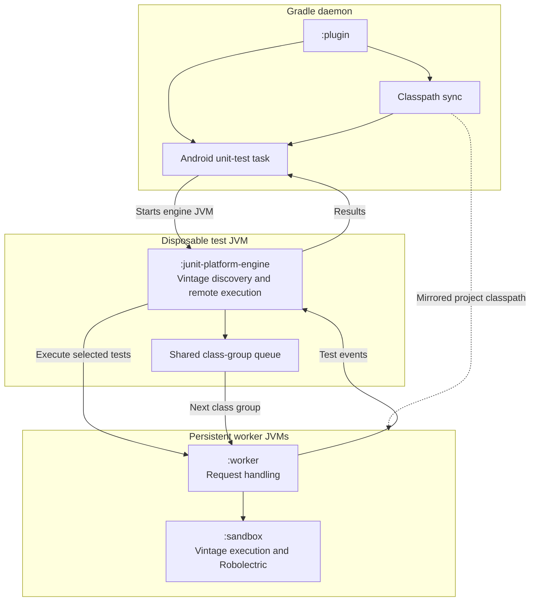
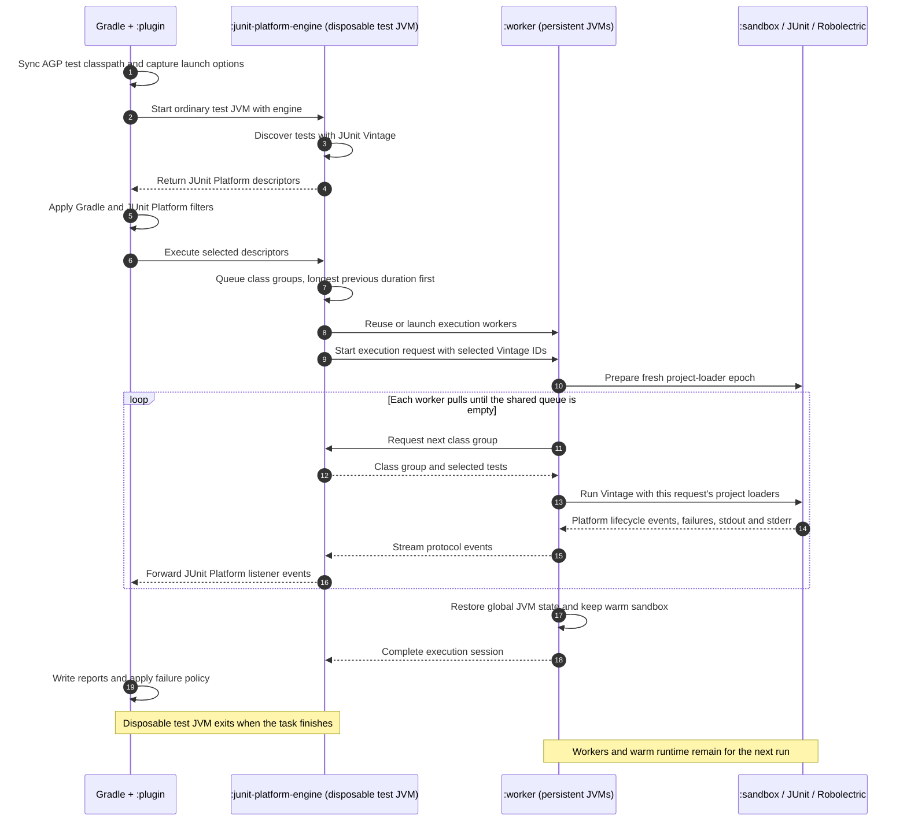
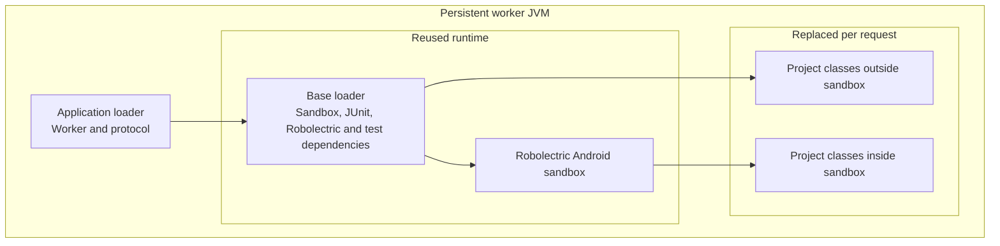

# robolectric-daemon

A Gradle plugin for Android unit tests that keeps Robolectric worker JVMs alive between Gradle
invocations. Reusing the workers avoids reloading Robolectric for every run; project classes are
refreshed between runs.

## Use the plugin

For a local checkout, include the plugin and its runtime projects in `settings.gradle.kts`:

```kotlin
pluginManagement {
  repositories {
    google()
    gradlePluginPortal()
    mavenCentral()
  }
  includeBuild("../robolectric-daemon")
}

includeBuild("../robolectric-daemon")
```

Apply it to an Android application or library module:

```kotlin
plugins {
  id("com.android.library")
  id("com.fueledbycaffeine.robolectric-daemon")
}
```

The plugin configures each variant's `test<Variant>UnitTest` task. No additional setup is needed.
Keep using JUnit 4 and Robolectric dependencies as usual.

## Behavior

- `maxParallelForks` sets the number of persistent workers. Workers share a queue and run test
  classes with longer previous durations first.
- Project class changes reload project classes. Dependency, resource, or Robolectric-instrumented
  class changes rebuild the warm runtime in the same worker process. Runtime artifact or JVM launch
  changes restart the worker.
- Gradle still handles test filters, reports, lifecycle callbacks, and up-to-date and build-cache
  checks. Each non-cached run starts a disposable test JVM for discovery and result forwarding.
- `-Probolectric.daemon=false` disables workers. Workers are disabled by default when the `CI`
  environment variable or `ci` system property is present; use `-Probolectric.daemon=true` to
  enable them.
- JUnit Platform, TestNG, JUnit categories, `--debug-jvm`, `forkEvery`, and Java agents use
  Gradle's normal test JVMs instead of persistent workers.
- Run `./gradlew :module:stopRobolectricDaemon` to stop a module's workers. `clean` removes their
  state, and idle workers exit after one hour.

The plugin is intended for repeated test runs; the first run still has to start the workers and
load Robolectric.

## Architecture

Gradle remains responsible for the test task. A disposable engine JVM discovers tests, forwards
results, and schedules work to persistent worker JVMs.

The shared protocol module defines the cross-process file and property names in
[`DaemonContract`](protocol/src/main/kotlin/com/fueledbycaffeine/robolectricdaemon/DaemonContract.kt),
used by both their writers and readers.



### Test-task execution

This is the enabled path for a test task that is not up to date or restored from the build cache.
The engine uses JUnit Vintage for local discovery. Workers only execute selected tests.



Discovery constructs JUnit 4 runners in the disposable test JVM but does not run tests. Workers
are contacted only for execution. Each worker uses one project-loader epoch per execution request,
not one per class group. Worker requests are authenticated with a per-worker token. The client
delivers that token through the worker's standard-input pipe, never as a command-line argument
or environment variable. Discovery state contains the token and is owner-readable/writable on
POSIX filesystems; protect the worker directory with equivalent ACLs on other filesystems.

Workers bind only to loopback, but execute tests with the launching account's privileges.
Classloader isolation is not a security sandbox: only run trusted test code, and use OS-level
isolation for untrusted workloads.

Workers execute with a JUnit Platform launcher configured explicitly for Vintage, with automatic
engine/listener registration and Vintage parallel execution disabled. Selected unique IDs preserve
runner ownership and parameterized-test identities. Platform container, skip, completion, and
dynamic-registration events are forwarded to Gradle; the bridge only translates the engine ID.
The sandbox runtime supplies its Vintage/Platform dependencies alongside the worker support JAR.

Test failures are sent Java-serialized, so Gradle reports their real types, causes, and suppressed
exceptions. The client accepts only exception graphs—throwables, stack frames, strings, boxed
primitives, lists, and opentest4j value wrappers—never general deserialization gadgets. Failures
it can't read, including Robolectric-instrumented Android exceptions, fall back to a reconstructed
`RuntimeException` chain that preserves each exception's type name, message, and stack frames.

Classpath mirroring uses Gradle's incremental file changes. Only changed directory files are
copied; changed project JARs are expanded with Gradle's archive and sync operations. A manifest
tracks mirrored files and resource hashes, so ordinary class edits do not invalidate warm sandboxes.
The live mirror is local state rather than a task output: all updates and full rebuilds happen
under the worker-client lock, including recovery from missing mirrored files.

### Classloader lifetimes

Workers keep the test runtime warm and replace project loaders for each execution request.
This resets project statics without reloading Robolectric on every run.

The worker and handwritten protocol code use Kotlin, targeting Java 11. Their Kotlin stdlib stays
in the worker's application loader. The test-runtime loader has a protocol-only parent, backed by
the artifact containing `WorkerRuntime`, which delegates platform classes to the platform loader.
Classes in that artifact retain their application-loader identities, including protocol messages
and the private protobuf runtime. Sharing follows artifact membership, not a package-name allowlist.
Tests therefore use their own Kotlin runtime, if any. The sandbox remains Java.

The worker implementation separates socket handling, authentication, and state-file lifecycle in
[`WorkerServer`](worker/src/main/kotlin/com/fueledbycaffeine/robolectricdaemon/WorkerServer.kt),
execution orchestration in
[`WorkerMain`](worker/src/main/kotlin/com/fueledbycaffeine/robolectricdaemon/WorkerMain.kt),
runtime lifetime and reload decisions in
[`WorkerBase`](worker/src/main/kotlin/com/fueledbycaffeine/robolectricdaemon/WorkerBase.kt),
the isolated loaders in
[`WorkerClassLoaders`](worker/src/main/kotlin/com/fueledbycaffeine/robolectricdaemon/WorkerClassLoaders.kt),
JVM-state restoration and temporary-file cleanup in
[`WorkerExecution`](worker/src/main/kotlin/com/fueledbycaffeine/robolectricdaemon/WorkerExecution.kt),
and protocol output adapters in
[`WorkerOutput`](worker/src/main/kotlin/com/fueledbycaffeine/robolectricdaemon/WorkerOutput.kt).
The server delivers authenticated run requests synchronously through
[`WorkerRunSession`](worker/src/main/kotlin/com/fueledbycaffeine/robolectricdaemon/WorkerRunSession.kt).
Execution reads the request, emits events, and requests class groups through that session without
handling sockets or protocol framing.
Execution stages produce immutable
[`WorkerRunResult`](worker/src/main/kotlin/com/fueledbycaffeine/robolectricdaemon/WorkerRunResult.kt)
values, preserving completed counts if a later stage fails. Reload states and reasons are typed in
[`WorkerReload`](worker/src/main/kotlin/com/fueledbycaffeine/robolectricdaemon/WorkerReload.kt);
their human-readable summary labels remain stable.



## Publishing

The plugin and its runtime artifacts are released together with the same version. Consumers need
to add the release repository to both `pluginManagement.repositories` and
`dependencyResolutionManagement.repositories`; the plugin does not add repositories.

To publish locally, run:

```sh
./gradlew publishToMavenLocal
```

Then add `mavenLocal()` to both repository blocks in the consuming build.

## Development

```sh
./gradlew ktfmtFormat
./gradlew build :plugin:detektMain :plugin:detektFunctionalTest
```

The build includes plugin validation and functional tests. Detekt uses the sibling
`../detekt-gradle-rules` included build.

The implementation is split across five projects:

- `:plugin` integrates with Android Gradle Plugin and configures test tasks.
- `:junit-platform-engine` uses Vintage to discover JUnit 3/4 tests and forwards execution to workers.
- `:worker` manages persistent worker processes.
- `:sandbox` executes JUnit 3/4 tests through Vintage, including Robolectric tests.
- `:protocol` defines messages shared between the engine and workers.
